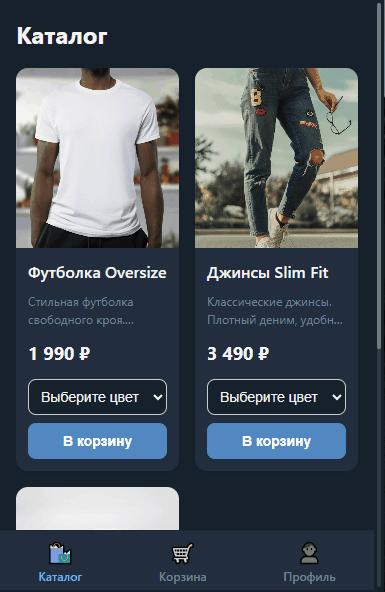

# TG Shop MiniApp 🛍️

**English** | [Русский](README.ru.md)


A full-stack E-commerce Telegram Mini App. The project features a product catalog, shopping cart, checkout process, secure YooKassa payment integration, and a user profile with order history.

## 📖 About The Project

The project is built with a focus on security and modern development standards. Authentication is handled via Telegram WebApp `initData` validation using HMAC-SHA256. The backend is fully asynchronous, and the infrastructure is containerized with Docker for easy deployment.

## 🎥 Demo

> *A GIF demonstration of the app (Catalog -> Cart -> Checkout) will be placed here.*
> *(To add it, record your screen, save it as `demo.gif` in the `docs/images/` folder, and uncomment the line below)*

<!--  -->

## 📸 Screenshots

> *UI Screenshots (will be added after final UI polishing).*

<!--
| Catalog | Cart | Profile |
| :---: | :---: | :---: |
|  |  |  |
-->

## 📂 Project Structure

```text
tg-shop-miniapp/
├── .github/workflows/   # CI/CD pipelines (GitHub Actions)
├── docs/                # Documentation and screenshots
├── migrations/          # Database migrations (Alembic)
├── src/                 # Backend source code (FastAPI)
│   └── app/
├── tests/               # Unit tests (Pytest)
├── webapp/              # Frontend source code (React, Vite)
│   ├── public/
│   └── src/
├── docker-compose.yml   # Docker configuration
├── Dockerfile           # Backend Dockerfile
├── pyproject.toml       # Python dependencies (uv)
└── README.md            # Documentation
```

## 🚀 Tech Stack

- **Backend:** Python 3.11, FastAPI, SQLAlchemy 2.0 (async), Alembic, PostgreSQL.
- **Frontend:** React 19, TypeScript, Vite, Zustand (state management), Axios.
- **Infrastructure:** Docker, Docker Compose, Nginx (reverse proxy & static serving).
- **Testing & CI:** Pytest, Ruff (linter), GitHub Actions.

## ✨ Features

- [x] **Authentication:** Secure login via Telegram `initData` (HMAC).
- [x] **Catalog:** Product display with variants (colors, sizes).
- [x] **Cart:** Add, update quantity, persist in `localStorage`.
- [x] **Checkout:** User data validation, order creation.
- [x] **Payments:** YooKassa integration (payment creation, webhooks).
- [x] **Profile:** Order history with status tracking.
- [x] **Infrastructure:** Docker-compose environment, Nginx reverse-proxy.
- [x] **CI/CD:** GitHub Actions configured (linters, build, tests).

## ⚙️ Environment Variables

To run the application, you need to create a `.env` file in the root directory (based on `.env.example`).

| Variable | Description | Example |
| :--- | :--- | :--- |
| `POSTGRES_USER` | Database user name | `postgres` |
| `POSTGRES_PASSWORD` | Database password | `mysecretpassword` |
| `POSTGRES_DB` | Database name | `tg_shop` |
| `JWT_SECRET` | Secret key for JWT signing | `super_secret_random_string` |
| `TELEGRAM_BOT_TOKEN` | Your bot token from BotFather | `123456:ABC-DEF1234ghIkl-zyx57W2v1u123ew11` |
| `YOOKASSA_SHOP_ID` | YooKassa Shop ID | `123456` |
| `YOOKASSA_SECRET_KEY` | YooKassa Secret Key | `test_abc123...` |

## 🛠️ Quick Start (Docker)

1. Copy the environment variables file:
   ```bash
   cp .env.example .env
   ```
2. Build and start the containers:
   ```bash
   docker compose up --build -d
   ```
3. Access the application:
   - Frontend: `http://localhost:3000`
   - API (Swagger): `http://localhost:8000/docs`

## 💻 Local Development

### Backend
```bash
uv sync
uv run alembic upgrade head
make run
```

### Frontend
```bash
cd webapp
npm install
npm run dev
```

### Testing
```bash
uv run pytest -v
```

## 📚 Documentation

- [Project Architecture & DB Schema (RU)](docs/ARCHITECTURE.ru.md)

## 🤝 Contact

If you have any questions or suggestions, feel free to reach out:
- **Telegram:** [@YOUR_TELEGRAM_USERNAME](https://t.me/YOUR_TELEGRAM_USERNAME)
- **GitHub:** [YOUR_GITHUB_USERNAME](https://github.com/YOUR_GITHUB_USERNAME)

## 📄 License

This project is licensed under the MIT License - see the [LICENSE](LICENSE) file for details.
