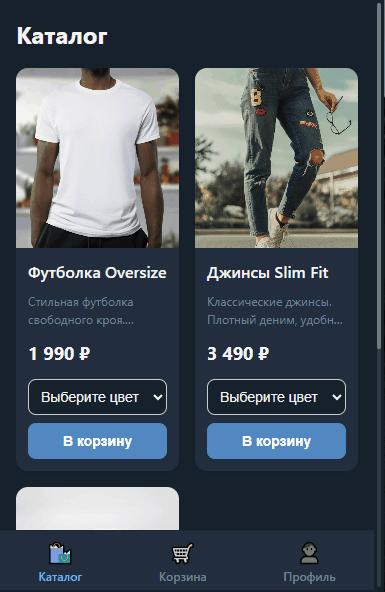
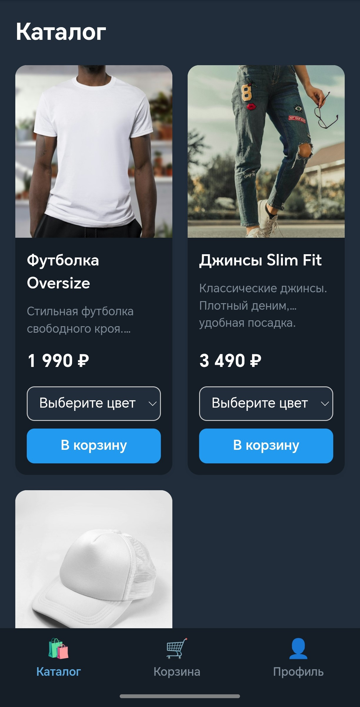
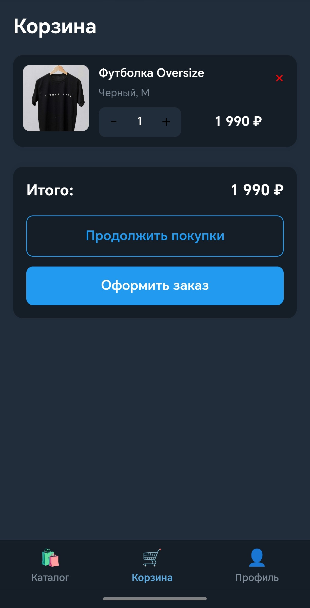
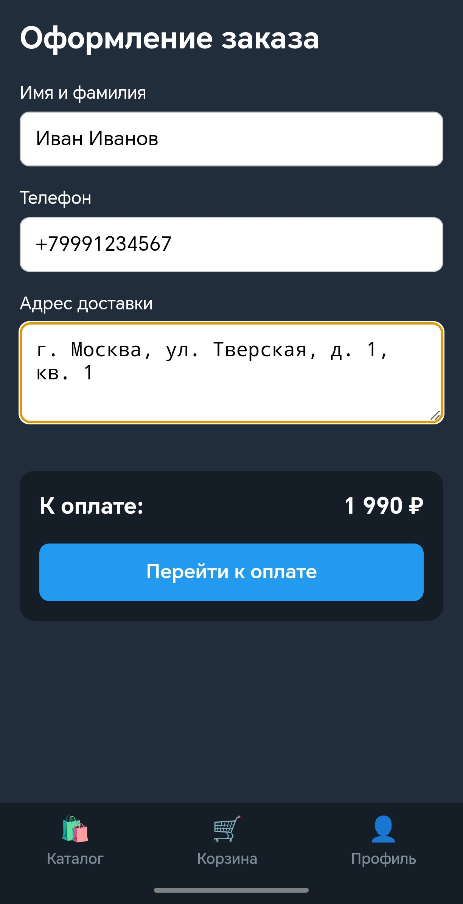
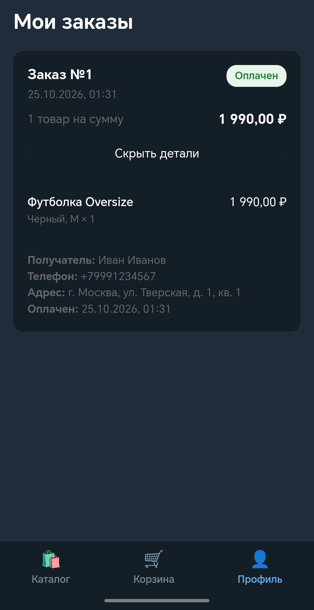

# TG Shop MiniApp 🛍️

[English](README.md) | **Русский**


Полноценный E-commerce Telegram Mini App. Проект включает в себя каталог товаров, удобную корзину, оформление заказа, безопасную интеграцию с платежной системой ЮKassa и личный кабинет с историей заказов.

## 📖 О проекте

Проект разработан с упором на безопасность и современные стандарты разработки. Авторизация происходит через валидацию `initData` от Telegram WebApp с использованием HMAC-SHA256. Для десктопной версии реализован безопасный вход через Telegram Login Widget. Бэкенд полностью асинхронный, а инфраструктура упакована в Docker-контейнеры для легкого развертывания.

## 🎥 Демонстрация



## 📸 Скриншоты

| Каталог | Корзина |
| :---: | :---: |
|  |  |

| Оформление заказа | Профиль |
| :---: | :---: |
|  |  |

## 📂 Структура проекта

```text
tg-shop-miniapp/
├── .github/workflows/   # CI/CD пайплайны (GitHub Actions)
├── docs/                # Документация и скриншоты
├── migrations/          # Миграции базы данных (Alembic)
├── src/                 # Исходный код бэкенда (FastAPI)
│   └── app/
├── tests/               # Юнит-тесты (Pytest)
├── webapp/              # Исходный код фронтенда (React, Vite)
│   ├── public/
│   └── src/
├── docker-compose.yml   # Конфигурация Docker
├── Dockerfile           # Dockerfile для бэкенда
├── pyproject.toml       # Зависимости Python (uv)
└── README.md            # Документация
```

## 🚀 Технологический стек

- **Бэкенд:** Python 3.11, FastAPI, SQLAlchemy 2.0 (async), Alembic, PostgreSQL.
- **Фронтенд:** React 19, TypeScript, Vite, Zustand (стейт-менеджер), Axios.
- **Инфраструктура:** Docker, Docker Compose, Nginx (прокси и раздача статики), Certbot.
- **Тестирование и CI:** Pytest, Ruff (линтер), GitHub Actions.

## ✨ Реализованный функционал

- [x] **Авторизация:** Безопасный вход через Telegram `initData` (HMAC) и Login Widget.
- [x] **Каталог:** Отображение товаров с вариантами (цвета, размеры).
- [x] **Корзина:** Добавление, изменение количества, сохранение в `localStorage`.
- [x] **Оформление заказа:** Валидация данных пользователя, создание заказа.
- [x] **Платежи:** Интеграция с ЮKassa (создание платежа, вебхуки).
- [x] **Личный кабинет:** История заказов с автообновлением статусов.
- [x] **Инфраструктура:** Docker-compose окружение, Nginx reverse-proxy, SSL.
- [x] **CI/CD:** Настроен GitHub Actions (линтеры, сборка, тесты).

## ⚙️ Переменные окружения

Для работы приложения необходимо создать файл `.env` в корне проекта (на основе `.env.example`).

| Переменная | Описание | Пример |
| :--- | :--- | :--- |
| `POSTGRES_USER` | Имя пользователя БД | `postgres` |
| `POSTGRES_PASSWORD` | Пароль БД | `mysecretpassword` |
| `POSTGRES_DB` | Название базы данных | `tg_shop` |
| `JWT_SECRET` | Секретный ключ для подписи JWT | `super_secret_random_string` |
| `TELEGRAM_BOT_TOKEN` | Токен вашего бота от BotFather | `123456:ABC-DEF...` |
| `YUKASSA_SHOP_ID` | ID магазина в ЮKassa | `123456` |
| `YUKASSA_SECRET_KEY` | Секретный ключ ЮKassa | `test_abc123...` |

## 🛠️ Быстрый запуск (Docker)

1. Скопируйте файл переменных окружения:
   ```bash
   cp .env.example .env
   ```
2. Соберите и запустите контейнеры:
   ```bash
   docker compose up --build -d
   ```
3. Приложение доступно по адресам:
   - Фронтенд: `http://localhost:3000`
   - API (Swagger): `http://localhost:8000/docs`

## 💻 Локальная разработка

### Бэкенд
```bash
uv sync
uv run alembic upgrade head
make run
```

### Фронтенд
```bash
cd webapp
npm install
npm run dev
```

### Тестирование
```bash
uv run pytest -v
```

## 📚 Документация

- [Архитектура проекта и схема БД](docs/ARCHITECTURE.ru.md)

## 🤝 Контакты и Обратная связь

Если у вас есть вопросы или предложения, свяжитесь со мной:
- **Telegram:** [@TravkinVladimir](https://t.me/TravkinVladimir)
- **GitHub:** [@VladimirTravkin](https://github.com/VladimirTravkin)
- **Email:** [vpro68@mail.ru](mailto:vpro68@mail.ru)

## 📄 Лицензия

Этот проект распространяется под лицензией MIT. Подробности в файле [LICENSE](LICENSE).
