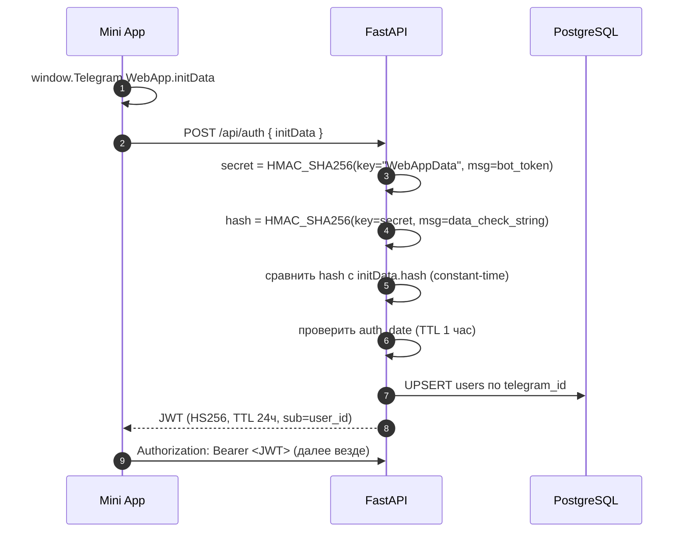
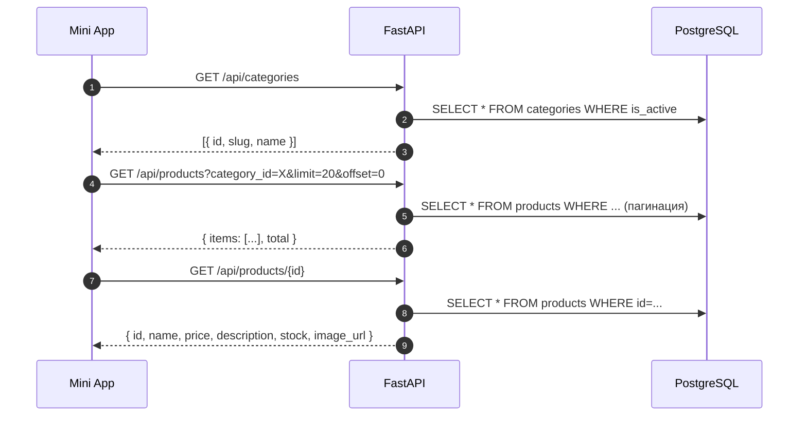
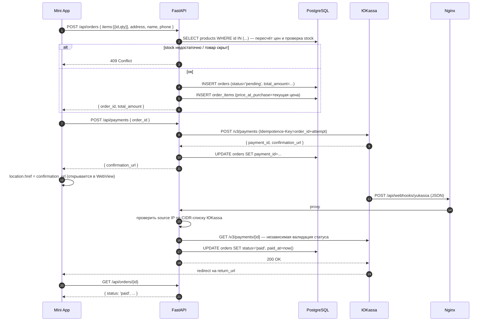
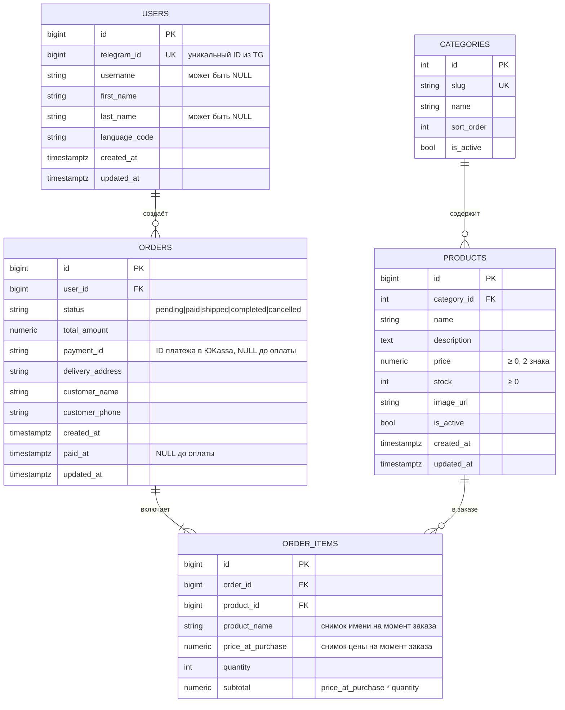
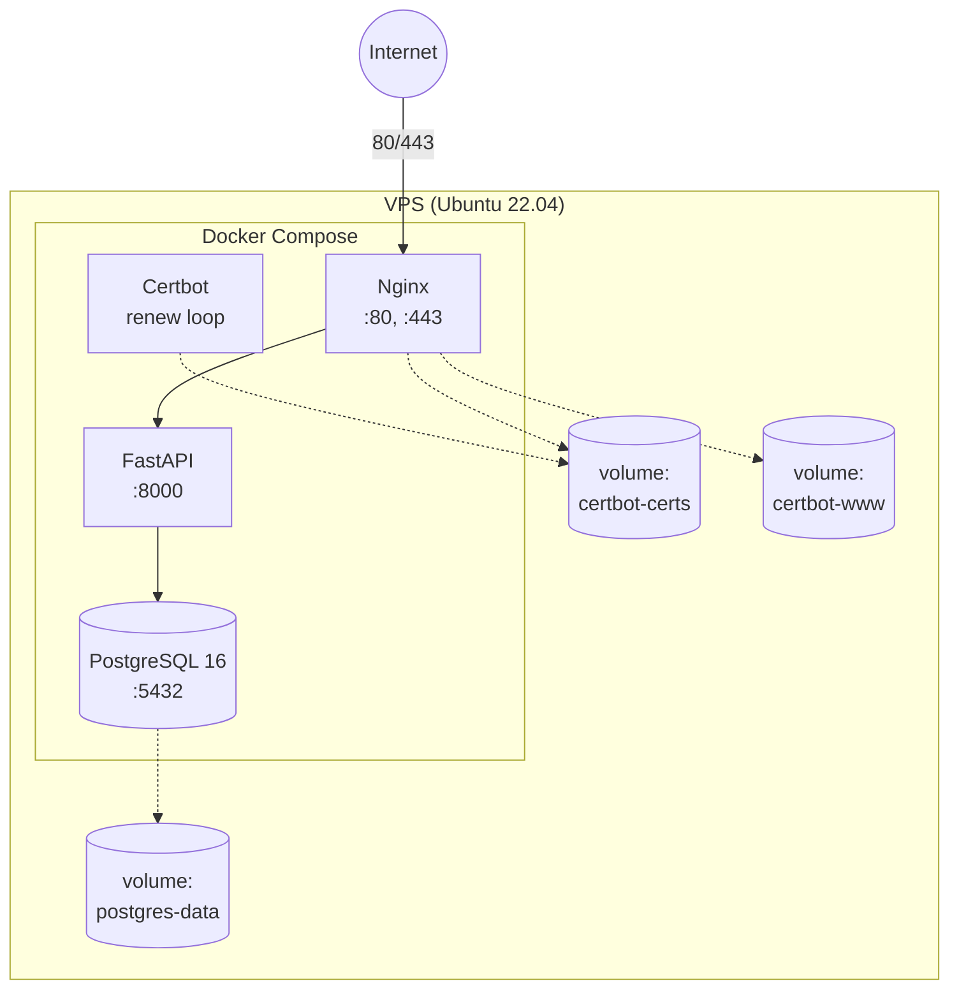

# Архитектура проекта: E-commerce Telegram Mini App

> Документ описывает архитектуру, потоки данных, модель данных и принятые
> инженерные решения. Цель — объяснить **почему** система устроена именно так,
> а не просто перечислить компоненты.

## Оглавление

1. [Обзор](#1-обзор)
2. [Компоненты и схема](#2-компоненты-и-схема)
3. [Потоки данных](#3-потоки-данных)
4. [Модель данных](#4-модель-данных)
5. [Безопасность](#5-безопасность)
6. [Инфраструктура](#6-инфраструктура)
7. [Деплой](#7-деплой)
8. [Допущения по нагрузке](#8-допущения-по-нагрузке)
9. [Вне рамок MVP](#9-вне-рамок-mvp)
10. [Trade-offs (ADR-lite)](#10-trade-offs-adr-lite)

---

## 1. Обзор

**Продукт.** Магазин внутри Telegram, открывающийся как Mini App (WebApp
внутри WebView Telegram). Пользователь проходит полный цикл покупки, не
покидая мессенджер: каталог → корзина → оформление → оплата ЮKassa → история
заказов в личном кабинете.

**Ключевая идея.** Уйти от комиссий агрегаторов (маркетплейсы) и получить
прямой канал продаж в Telegram, где уже находится аудитория бренда.

**Что входит в MVP:**

- Витрина: категории, список товаров, карточка товара.
- Корзина (клиентская, `localStorage`) с серверным пересчётом при оформлении.
- Оформление заказа с адресом доставки.
- Онлайн-оплата ЮKassa (тестовый магазин) + вебхук.
- Личный кабинет: история заказов и статусы.
- Авторизация через Telegram `initData` (HMAC-SHA256), сессия — JWT.

**Стек:**

| Слой | Технологии |
|---|---|
| Backend | Python 3.11, FastAPI, SQLAlchemy 2.0 (async), Alembic, pydantic-settings, uvicorn |
| Frontend | HTML5, CSS3, Vanilla JS, Telegram WebApp SDK |
| БД | PostgreSQL 16 |
| Платежи | ЮKassa (тестовый магазин) |
| Безопасность | JWT (HS256), HMAC-SHA256, slowapi (rate limiting) |
| Инфраструктура | Docker, Docker Compose, Nginx, Certbot (Let's Encrypt) |
| Линтер | Ruff |

---

## 2. Компоненты и схема

```mermaid
flowchart LR
    U[Пользователь<br/>в Telegram] -->|открывает| WA[WebView<br/>Mini App / Vanilla JS]
    WA -->|HTTPS| N[Nginx<br/>reverse-proxy + статика]
    N -->|статика| S[webapp/<br/>index.html, js, css]
    N -->|/api/* proxy| F[FastAPI<br/>uvicorn]
    F -->|asyncpg| DB[(PostgreSQL 16<br/>в Docker)]
    F -->|HTTPS REST| YK[ЮKassa API<br/>создание платежа]
    YK -->|webhook| N
    F -.->|GET /v3/payments/{id}<br/>валидация вебхука| YK
```

**Роли компонентов:**

- **WebView / Mini App** — статический фронтенд, инициализируется через
  `window.Telegram.WebApp`. Работает в контексте Telegram: доступ к `initData`,
  `themeParams`, `MainButton`, `BackButton`.
- **Nginx** — единая точка входа. Раздаёт статику из `webapp/`, проксирует
  `/api/*` на FastAPI, терминирует SSL (Certbot).
- **FastAPI** — вся бизнес-логика: авторизация, каталог, заказы, платежи,
  вебхуки. Полностью асинхронный (async SQLAlchemy + asyncpg).
- **PostgreSQL 16** — единственный источник истины по данным (пользователи,
  товары, заказы).
- **ЮKassa** — внешний провайдер платежей. Общение двустороннее: исходящие
  запросы на создание платежа + входящие вебхуки о смене статуса.

---

## 3. Потоки данных

### 3.1. Авторизация через `initData`



- `data_check_string` — все поля `initData` (кроме `hash`), отсортированные
  по алфавиту, склеенные через `\n` в формате `key=value`.
- `auth_date` проверяется, чтобы защититься от replay-атак старым `initData`.
- JWT — **stateless**; бэкенд не хранит сессии. TTL 24ч — компромисс между
  безопасностью и UX (пользователь не логинится заново каждый час).

### 3.2. Каталог



Все эндпоинты каталога — **публичные** (JWT не требуется). Это осознанно:
витрина должна открываться максимально быстро, без «прогрева» авторизации.

### 3.3. Заказ + оплата



**Почему два шага (`/orders` + `/payments`), а не один?**

- Заказ создаётся и фиксируется в БД **до** обращения в ЮKassa. Если ЮKassa
  недоступна — заказ остаётся `pending`, пользователь может попробовать
  оплатить позже (из личного кабинета).
- Создание платежа — **идемпотентная** операция (`Idempotence-Key`), защищает
  от дублей при повторных кликах.

**Почему валидация через `GET /v3/payments/{id}`, а не только по подписи?**

- Подпись вебхука + проверка IP — необходимые, но не достаточные условия.
  Единственный **достоверный** источник статуса платежа — сам ЮKassa.
  Мы запрашиваем статус напрямую перед обновлением заказа. Это защита от
  подделки вебхука и от рассинхронизации.

---

## 4. Модель данных



**Ключевые решения по модели:**

- **`order_items` хранит снимки** `product_name` и `price_at_purchase`, а не
  только FK на `products`. Если товар переименуют или поменяют цену — история
  заказа не «поедет». Это стандарт для e-commerce.
- **`payment_id` и `paid_at`** — не статусы, но критичные поля: без
  `payment_id` невозможно сопоставить вебхук с заказом, без `paid_at` —
  построить историю.
- **Денежные поля — `numeric`, не `float`.** Float даёт ошибки округления;
  для денег это недопустимо.
- **`status` — строка с CHECK-констрейнтом** (или Enum в SQLAlchemy).
  Значения: `pending`, `paid`, `shipped`, `completed`, `cancelled`.

**Конечный автомат статусов:**

| Из | Событие | В |
|---|---|---|
| `pending` | вебхук `payment.succeeded` + валидация | `paid` |
| `pending` | таймаут / ручная отмена | `cancelled` |
| `paid` | отгрузка | `shipped` |
| `shipped` | доставлено | `completed` |
| `paid` | возврат (в MVP — вручную) | `cancelled` |

Смена статуса — **только через единый обработчик** `transition(order, event)`,
который проверяет допустимость перехода. Прямое присваивание `order.status = "paid"`
в коде — запрещено (кроме самого обработчика).

---

## 5. Безопасность

### 5.1. Валидация `initData` (HMAC-SHA256)

Алгоритм (официальный Telegram, [docs](https://core.telegram.org/bots/webapps#validating-data-received-via-the-mini-app)):

1. `secret_key = HMAC_SHA256(key="WebAppData", msg=bot_token)`
2. `data_check_string` — все пары `key=value` из `initData`, **кроме `hash`**,
   отсортированные по ключу и склеенные через `\n`.
3. `computed_hash = HMAC_SHA256(key=secret_key, msg=data_check_string)`
4. Сравнить `computed_hash` с `initData.hash` **в constant-time**
   (`hmac.compare_digest`).
5. Проверить `auth_date` — не старше 1 часа (защита от replay).

Любое расхождение → `401 Unauthorized`. Никаких «мягких» режимов.

### 5.2. JWT-сессии

- Алгоритм: **HS256**, секрет — `JWT_SECRET` из `.env` (≥ 32 байта, генерируется
  через `openssl rand -hex 32`).
- Payload: `sub` (user_id), `iat`, `exp` (TTL 24ч).
- Stateless: бэкенд не хранит сессий → горизонтальное масштабирование «из коробки».
- Токен передаётся в `Authorization: Bearer <jwt>`.

### 5.3. Rate limiting (slowapi)

| Эндпоинт | Лимит | Зачем |
|---|---|---|
| `POST /api/auth` | 10/мин на IP | антибрутфорс initData |
| `POST /api/orders` | 5/мин на пользователя | защита от спама заказами |
| `GET /api/profile` | 30/мин на пользователя | защита от парсинга |

При превышении → `429 Too Many Requests` с заголовком `Retry-After`.
Для MVP хранилище в памяти; в README фиксируем: в проде — Redis.

### 5.4. Вебхук ЮKassa

Три уровня защиты:

1. **Проверка `source.ip`** по CIDR-списку ЮKassa (список в `.env`).
2. **Проверка подписи** тела запроса (SHA-256 HMAC из заголовка).
3. **Независимая валидация** через `GET /v3/payments/{id}` к API ЮKassa.

Даже если злоумышленник подделает запрос — п.3 отклонит его, потому что
статус берётся напрямую у провайдера.

### 5.5. Прочее

- **SQL-инъекции:** исключены за счёт ORM (параметризованные запросы).
- **XSS:** фронтенд вставляет данные через `textContent`, не `innerHTML`.
- **CORS:** разрешён только origin Telegram Mini App (в проде — конкретный домен).
- **Секреты:** только в `.env`, в репо — `.env.example` с пустыми значениями.
- **HTTPS:** обязательный, через Certbot (Let's Encrypt).
- **Валидация входа:** все тела запросов — Pydantic-модели со `strict`-режимом
  где возможно; отказ от «лишних» полей.

---

## 6. Инфраструктура



**Сервисы `docker-compose.yml`:**

| Сервис | Образ | Роль |
|---|---|---|
| `nginx` | `nginx:alpine` | reverse-proxy + статика + SSL |
| `backend` | build из `Dockerfile` | FastAPI + uvicorn |
| `db` | `postgres:16-alpine` | PostgreSQL с volume |
| `certbot` | `certbot/certbot` | выдача и автообновление сертификата |

**Переменные `.env` (без значений, только ключи):**

```
# App
APP_ENV=production
APP_BASE_URL=https://<domain>
API_PREFIX=/api

# Database
POSTGRES_USER=
POSTGRES_PASSWORD=
POSTGRES_DB=
DATABASE_URL=postgresql+asyncpg://<user>:<pass>@db:5432/<db>

# Telegram
TELEGRAM_BOT_TOKEN=
TELEGRAM_BOT_USERNAME=

# Auth
JWT_SECRET=
JWT_TTL_HOURS=24
INIT_DATA_TTL_SECONDS=3600

# ЮKassa
YUKASSA_SHOP_ID=
YUKASSA_SECRET_KEY=
YUKASSA_RETURN_URL=https://<domain>/payment/return
YUKASSA_WEBHOOK_IP_ALLOWLIST=

# Rate limiting
RATE_LIMIT_AUTH=10/minute
RATE_LIMIT_ORDERS=5/minute
RATE_LIMIT_PROFILE=30/minute
```

---

## 7. Деплой и CI

**Основной хостинг:** Oracle Cloud Always Free (Ubuntu VPS).

1. Создать VM (Ubuntu 22.04, Ampere или AMD — что выдаст Oracle).
2. Открыть порты 80/443 в Security List.
3. Установить Docker + Docker Compose.
4. Клонировать репозиторий, заполнить `.env`.
5. `make up` — поднять сервисы.
6. `make certbot-init` — получить первый сертификат Let's Encrypt.
7. Настроить DNS A-запись домена на IP VM.
8. Проверить `https://<domain>/health` → `{"status":"ok"}`.

**Запасной хостинг** (если Oracle выдаст ошибку capacity): Google Cloud Run
(backend, контейнер) + Aiven (managed PostgreSQL). Образы совместимы —
разница только в способе деплоя.

**CI (GitHub Actions).** На каждый push и pull request в `main` запускается
workflow `.github/workflows/ci.yml`:

| Job | Что делает |
|---|---|
| `lint` | `ruff check .` и `ruff format --check .` |
| `test` | поднимает PostgreSQL (service container), применяет `alembic upgrade head`, запускает `pytest` с покрытием |
| `build` | собирает Docker-образ `backend` (без push) — проверка, что Dockerfile валиден |

CI **не деплоит** автоматически (deploy — ручной, см. выше). Это осознанно:
на MVP безопаснее контролировать выкладку вручную. Ветка `main` защищена —
merge возможен только при зелёном CI.

---

## 8. Допущения по нагрузке

Проект рассчитан на **малый и средний бизнес**: один бренд, один бот.

| Параметр | Оценка |
|---|---|
| Пользователи (MAU) | 1k – 50k |
| Одновременные сессии | до 500 |
| RPS на API (пик) | 50 – 200 |
| SKU в каталоге | 10 – 5 000 |
| Заказов в сутки | до 1 000 |
| Объём БД (год) | ≤ 10 GB |

Под эти цифры **одного** VPS + Docker Compose + PostgreSQL **достаточно**.
Горизонтальное масштабирование (реплики БД, Redis, несколько инстансов API,
CDN для статики) в MVP не нужно — но архитектура к нему готова:
stateless-API и JWT позволяют добавить инстансы без изменений кода.

---

## 9. Стандартные решения платформы и границы MVP

### 9.1. Стандарт для Telegram Mini App (не «урезание», а правильный паттерн)

Эти решения — не компромисс, а **общепринятый стандарт** для Mini App:

- **Авторизация только через Telegram `initData`.** Пароли и email в Mini App
  не нужны: платформа даёт проверенную идентификацию через HMAC-подпись.
  Это безопаснее и проще, чем классический логин/пароль.
- **Уведомления только через Telegram-бота.** Пользователь уже в мессенджере —
  email/SMS были бы лишним каналом и лишними расходами.

### 9.2. Вне рамок MVP (осознанно вынесено)

- **Админка** — товары и заказы заводятся через SQL/миграции; UI админки
  появится во второй итерации.
- **Серверная корзина** — синхронизация между устройствами (см. §10).
- **Мультивалютность** — только RUB.
- **Промокоды, скидки, акции.**
- **Возвраты через ЮKassa** — в MVP обрабатываются вручную.
- **Redis** — rate limit в памяти; в проде — Redis (отмечено в README).
- **Мультиязычность** — интерфейс на русском.
- **Автодеплой из CI** — CI проверяет, но не выкатывает (см. §7).

Эти пункты не «забыли» — они вынесены за скоуп, чтобы MVP был сфокусированным
и выпускался быстро. Каждый из них — очевидная точка роста.

---

## 10. Trade-offs (ADR-lite)

Короткие архитектурные решения с обоснованием.

| # | Решение | Альтернатива | Почему так |
|---|---|---|---|
| 1 | `pyjwt` для JWT | `python-jose` | Активнее поддерживается, меньше зависимостей, чистый API. `python-jose` долго без релизов. |
| 2 | Корзина — `localStorage` | Серверная корзина (таблицы `carts`/`cart_items`) | MVP: меньше таблиц, проще код, UX идентичен. Сервер **пересчитывает** цены при `POST /orders`. В проде при необходимости мигрируем на серверную. |
| 3 | JWT (stateless) | Серверные сессии + Redis | Горизонтальное масштабирование «из коробки», нет state на бэке. Минус — нельзя мгновенно «разлогинить»; для MVP приемлемо (TTL 24ч). |
| 4 | Двухшаговая оплата (`/orders` + `/payments`) | Один эндпоинт `/checkout` | Заказ фиксируется до обращения к ЮKassa. Если ЮKassa недоступна — заказ `pending`, можно оплатить позже. |
| 5 | Валидация вебхука через `GET /v3/payments/{id}` | Только подпись + IP | Единственный достоверный источник статуса — сам ЮKassa. Защита от подделки вебхука и рассинхронизации. |
| 6 | `slowapi` (in-memory) | Redis + `slowapi` | MVP на одном инстансе — in-memory достаточно. В README отмечено: в проде — Redis. |
| 7 | Снимки `product_name`/`price_at_purchase` в `order_items` | Только FK на `products` | История заказа не «поедет» при изменении товара. Стандарт e-commerce. |
| 8 | `numeric` для денег | `float` / `Decimal` в коде | В БД — `numeric(10,2)`, в коде — `Decimal`. Float даёт ошибки округления. |
| 9 | Единый обработчик переходов статусов | Прямое присваивание `order.status` | Защита от «статусного хаоса» и расхождений с платежами. |
| 10 | Mermaid в документации | ASCII-схемы | GitHub рендерит нативно; VS Code 1.121+ — нативно. Читается быстрее, не «плывёт». |
| 11 | GitHub Actions: lint + test + build, **без автодеплоя** | Полный CI/CD с автодеплоем | CI ловит регрессии на каждом PR; деплой на MVP оставлен ручным — безопаснее и проще откатывать. Автодеплой добавим, когда появится staging. |

---

## Приложение. Ссылки

- Telegram Mini Apps: <https://core.telegram.org/bots/webapps>
- Валидация `initData`: <https://core.telegram.org/bots/webapps#validating-data-received-via-the-mini-app>
- ЮKassa API: <https://yookassa.ru/developers/api>
- FastAPI: <https://fastapi.tiangolo.com/>
- SQLAlchemy 2.0 async: <https://docs.sqlalchemy.org/en/20/orm/extensions/asyncio.html>
