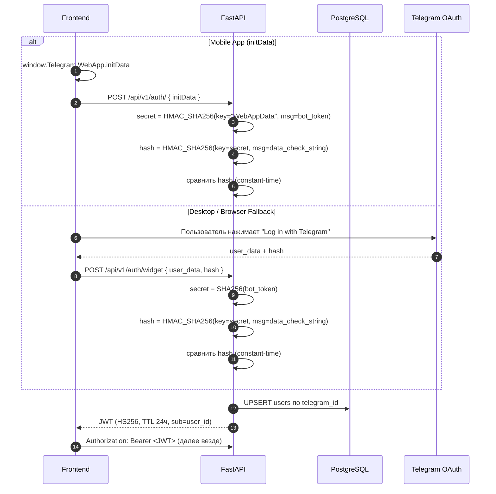
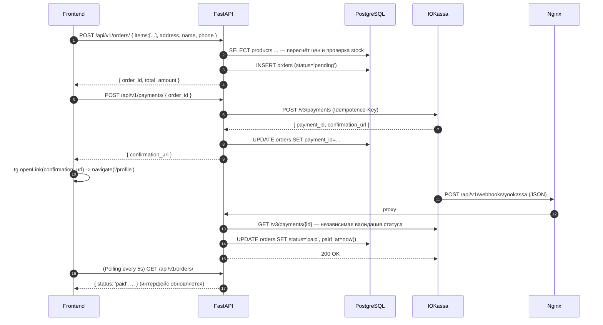
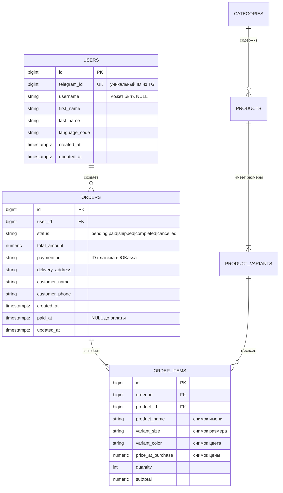
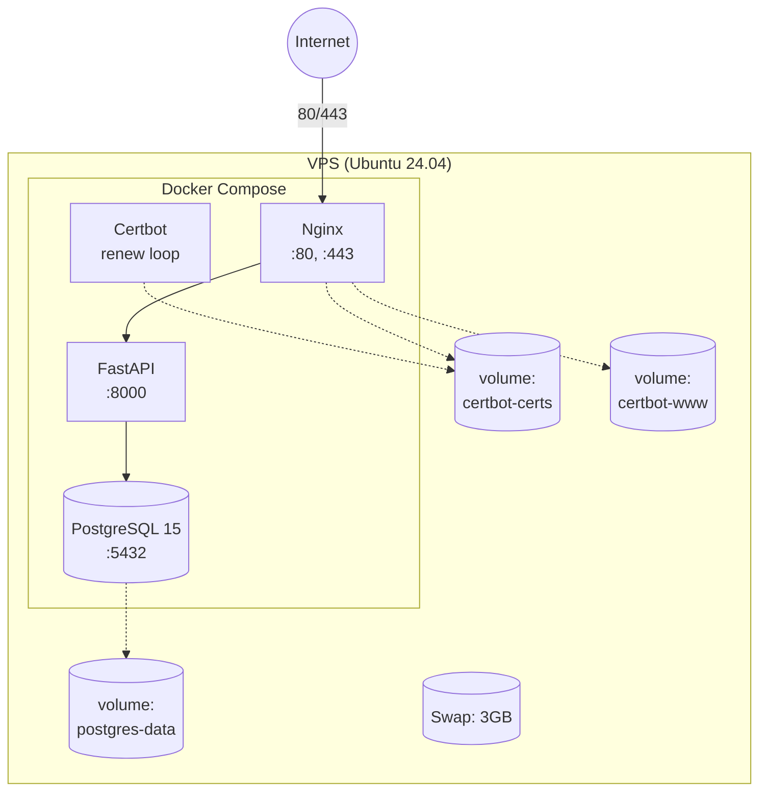

# Архитектура проекта: E-commerce Telegram Mini App

> Документ описывает архитектуру, потоки данных, модель данных и принятые
> инженерные решения. Цель — объяснить **почему** система устроена именно так,
> а не просто перечислить компоненты.

## Оглавление

1. [Обзор](#1-обзор)
2. [Компоненты и схема](#2-компоненты-и-схема)
3. [Потоки данных](#3-потоки-данных)
4. [Модель данных](#4-модель-данных)
5. [Безопасность](#5-безопасность)
6. [Инфраструктура](#6-инфраструктура)
7. [Деплой](#7-деплой)
8. [Допущения по нагрузке](#8-допущения-по-нагрузке)
9. [Вне рамок MVP](#9-вне-рамок-mvp)
10. [Trade-offs (ADR-lite)](#10-trade-offs-adr-lite)

---

## 1. Обзор

**Продукт.** Магазин внутри Telegram, открывающийся как Mini App (WebApp
внутри WebView Telegram) и в обычном браузере. Пользователь проходит полный цикл покупки, не
покидая мессенджер: каталог → корзина → оформление → оплата ЮKassa → история
заказов в личном кабинете.

**Ключевая идея.** Уйти от комиссий агрегаторов (маркетплейсы) и получить
прямой канал продаж в Telegram, где уже находится аудитория бренда.

**Что входит в MVP:**

- Витрина: категории, список товаров, карточка товара.
- Корзина (клиентская, `localStorage`) с серверным пересчётом при оформлении.
- Оформление заказа с адресом доставки.
- Онлайн-оплата ЮKassa (тестовый магазин) + вебхук.
- Личный кабинет: история заказов и статусы (с автообновлением).
- Авторизация через Telegram `initData` (HMAC-SHA256) + Telegram Login Widget для десктопа/браузера.

**Стек:**

| Слой | Технологии |
|---|---|
| Backend | Python 3.11, FastAPI, SQLAlchemy 2.0 (async), Alembic, pydantic-settings, uvicorn |
| Frontend | React 19, TypeScript, Vite, Zustand |
| БД | PostgreSQL 15 (в Docker) |
| Платежи | ЮKassa (тестовый магазин) |
| Безопасность | JWT (HS256), HMAC-SHA256, slowapi (rate limiting) |
| Инфраструктура | Docker, Docker Compose, Nginx, Certbot (Let's Encrypt), DuckDNS |
| Линтер | Ruff, ESLint |

---

## 2. Компоненты и схема

```mermaid
flowchart LR
    U[Пользователь<br/>Telegram / Browser] -->|открывает| WA[WebView / Browser<br/>React + TS]
    WA -->|HTTPS| N[Nginx<br/>reverse-proxy + статика]
    N -->|статика| S[webapp/<br/>index.html, js, css]
    N -->|/api/* proxy| F[FastAPI<br/>uvicorn]
    F -->|asyncpg| DB[(PostgreSQL 15<br/>в Docker)]
    F -->|HTTPS REST| YK[ЮKassa API<br/>создание платежа]
    YK -->|webhook| N
    F -.->|GET /v3/payments/{id}<br/>валидация вебхука| YK
```

**Роли компонентов:**

- **WebView / Mini App** — SPA на React + TypeScript, собирается через Vite. Работает как внутри Telegram, так и в браузере. Для браузера предусмотрен fallback-вход через Telegram Login Widget.
- **Nginx** — единая точка входа. Раздаёт статику из `webapp/`, проксирует `/api/*` на FastAPI, терминирует SSL (Certbot).
- **FastAPI** — вся бизнес-логика: авторизация, каталог, заказы, платежи, вебхуки. Полностью асинхронный (async SQLAlchemy + asyncpg).
- **PostgreSQL 15** — единственный источник истины по данным.
- **ЮKassa** — внешний провайдер платежей.

---

## 3. Потоки данных

### 3.1. Авторизация (Mini App и Desktop Fallback)

Для мобильного Telegram используется `initData`. Для браузера (или десктопного клиента, где `initData` пуст) используется **Telegram Login Widget**.



- `data_check_string` — все поля (кроме `hash`), отсортированные по алфавиту, склеенные через `\n`.
- **Важно:** секретный ключ для Mini App (`HMAC(bot_token, "WebAppData")`) отличается от секретного ключа для Login Widget (`SHA256(bot_token)`).
- JWT — **stateless**; бэкенд не хранит сессии.

### 3.2. Каталог

Все эндпоинты каталога — **публичные** (JWT не требуется). Витрина открывается максимально быстро, без «прогрева» авторизации.

### 3.3. Заказ + оплата



**Особенности реализации:**
- Фронтенд использует **Polling** (опрос каждые 5 секунд) на странице «Профиль», если есть заказы в статусе `pending`. Это позволяет обновить статус на «Оплачен» без перезагрузки страницы, даже если вебхук пришел с задержкой.
- При нажатии «Оплатить» фронтенд открывает ссылку через `tg.openLink()` и **сразу делает редирект** на страницу профиля, чтобы избежать зависания кнопки «Обработка...».

---

## 4. Модель данных



**Ключевые решения по модели:**
- **`order_items` хранит снимки** `product_name` и `price_at_purchase`, а не только FK. История заказа не «поедет» при изменении товара.
- **Денежные поля — `numeric`, не `float`.** Float даёт ошибки округления; для денег это недопустимо.
- **Конечный автомат статусов:** Смена статуса происходит только через единый обработчик `transition_status()`.

---

## 5. Безопасность

### 5.1. Валидация HMAC
- **Mini App:** `HMAC_SHA256(key="WebAppData", msg=bot_token)`.
- **Login Widget:** `SHA256(bot_token)`.
- В обоих случаях проверяется `auth_date` (TTL 1 час) для защиты от replay-атак.

### 5.2. JWT-сессии
- Алгоритм: **HS256**, секрет — `JWT_SECRET` из `.env`.
- Payload: `sub` (user_id), `iat`, `exp` (TTL 24ч).
- Stateless: бэкенд не хранит сессий → горизонтальное масштабирование «из коробки».

### 5.3. Вебхук ЮKassa
Для защиты от подделки вебхука используется **только независимая валидация** через `GET /v3/payments/{id}` к API ЮKassa. IP-фильтрация в текущей версии отключена, так как обращение к API провайдера является 100% надежным способом подтверждения статуса.

---

## 6. Инфраструктура



**Особенности деплоя на слабых VPS (2GB RAM):**
- Создан **Swap-файл на 1 ГБ** для предотвращения падения системы (OOM Killer) при сборке образов.
- Стратегия деплоя **«Локальная сборка -> Перенос» (Plan B)**: из-за нехватки RAM на VPS, Docker-образы (`backend.tar`, `frontend.tar`) собираются локально, переносятся по `scp` и загружаются на сервер через `docker load`. Это экономит ресурсы VPS и ускоряет процесс.

---

## 7. Деплой

**Хостинг:** obalko.sh (1 vCPU, 1GB RAM + 1GB Swap, 32GB NVMe, Ubuntu 24.04).

1. Установить Docker + Docker Compose.
2. Настроить Swap (3 ГБ).
3. Создать бесплатный домен на DuckDNS (`vm13-tg-shop.duckdns.org`).
4. Получить SSL-сертификат Let's Encrypt (Certbot) в режиме `standalone`.
5. Создать `.env.prod` с боевыми ключами.
6. Запустить базу данных и бэкенд (`docker compose -f docker-compose.prod.yml up -d db backend`).
7. Запустить Nginx и Certbot (`up -d`).
8. Настроить домен в `@BotFather` (`/setdomain`).
9. Настроить URL вебхуков в личном кабинете ЮKassa (`https://<domain>/api/v1/webhooks/yookassa`).

**CI (GitHub Actions).** На каждый push и pull request в `main` запускается
workflow `.github/workflows/ci.yml` (линтеры `ruff`, `eslint`, сборка `vite`, тесты `pytest`).

---

## 8. Допущения по нагрузке

Проект рассчитан на **малый и средний бизнес**: один бренд, один бот.
- MAU: 1k – 50k
- RPS на API (пик): 50 – 200
- SKU в каталоге: 10 – 5 000

Одного VPS + Docker Compose + PostgreSQL достаточно. Stateless-API и JWT позволяют добавить инстансы без изменений кода в будущем.

---

## 9. Вне рамок MVP

- **Админка** — товары и заказы заводятся через SQL/миграции.
- **Серверная корзина** — синхронизация между устройствами.
- **Мультивалютность** — только RUB.
- **Промокоды, скидки, акции.**
- **Возвраты через ЮKassa** — в MVP обрабатываются вручную.
- **Redis** — rate limit в памяти; в проде при масштабировании — Redis.

---

## 10. Trade-offs (ADR-lite)

| # | Решение | Обоснование |
|---|---|---|
| 1 | `pyjwt` для JWT | Активнее поддерживается, меньше зависимостей, чистый API. |
| 2 | Корзина — `localStorage` | Для MVP проще и быстрее. Сервер пересчитывает цены при создании заказа. |
| 3 | JWT (stateless) | Горизонтальное масштабирование «из коробки», нет state на бэке. |
| 4 | Двухшаговая оплата (`/orders` + `/payments`) | Заказ фиксируется до ЮKassa. Если она недоступна — заказ `pending`. |
| 5 | Валидация вебхука через `GET /v3/payments/{id}` | Единственный достоверный источник статуса — сам ЮKassa. Защита от подделки. |
| 6 | Polling (опрос) вместо WebSockets | В Mini App WebSockets требуют дополнительной поддержки. Для MVP опрос профиля раз в 5 секунд решает проблему обновления статуса без лишних затрат. |
| 7 | Telegram Login Widget для Desktop | Позволяет безопасно (через OAuth) авторизоваться в браузере, где `initData` недоступен. |
| 8 | `numeric` для денег | Float даёт ошибки округления. |
| 9 | Сборка образов локально (`docker save`/`load`) | Экономия RAM на VPS (2 ГБ), предотвращение падений при сборке Node.js/Python. |
